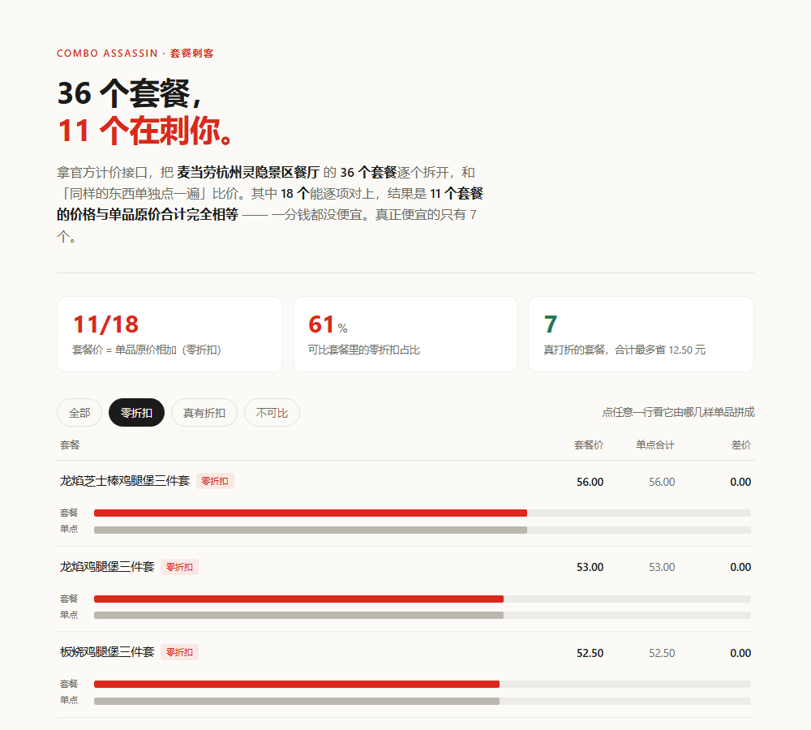

# 套餐刺客 · Combo Assassin

  

**把套餐拆开算一遍，看它到底刺没刺你。**

麦当劳的套餐不是折扣，是打包。

我把「麦当劳杭州灵隐景区餐厅」的 36 个套餐逐个拆开，用官方计价接口分别给「套餐」和「同样的东西单点一遍」报价，然后相减。

18 个能逐项对齐的套餐里，**11 个（61%）的价格与单品原价相加完全相等——一分没省**。

但真正值得说的是原因：

> **11 个套餐的「配菜位」定价，全部精确落在 25.50 元。**
> 也就是中薯条 14.50 + 可乐 11.00，分毫不差。

也就是说：**套餐价 = 汉堡单点价 + 25.50。** 它没有让价，只是把两样东西按原价绑在了汉堡上。

---



*「零折扣」筛选视图。红色条 = 套餐价，灰色条 = 同样的东西单点一遍。两根条一样长，就是一分没省。可离线打开 `demo/index.html` 交互查看。*

---

## 一张表看懂

「配菜位」= 套餐价 − 汉堡单点价。它表示你为了那杯可乐和那份薯条，实际付了多少钱。

| 套餐 | 套餐价 | 汉堡单点价 | **配菜位** | 配菜单点合计 | 让价 |
|---|---:|---:|---:|---:|---:|
| 麦香鸡中套餐 | 45.00 | 19.50 | **25.50** | 25.50 | 0.00 |
| 板烧鸡腿堡三件套 | 52.50 | 27.00 | **25.50** | 25.50 | 0.00 |
| 巨无霸三件套 | 54.50 | 29.00 | **25.50** | 25.50 | 0.00 |
| 龙焰芝士棒鸡腿堡三件套 | 56.00 | 30.50 | **25.50** | 25.50 | 0.00 |
| 培根安格斯厚牛堡三件套 | 63.50 | 39.00 | 24.50 | 25.50 | +1.00 |
| 麦辣鸡腿汉堡三件套 | 49.00 | 26.00 | 23.00 | 25.50 | +2.50 |

汉堡从 19.50 一路换到 39.00，配菜位纹丝不动地停在 25.50。

**16 个标准三件套，配菜位没有一个是 25.50 以上的。让价最多的那个，也只让了 2.50 元。**

---

## 三个可以自己跑出来的结论

```bash
git clone https://github.com/HadesWing/McDonald.git && cd McDonald
python mcd.py slot      # 配菜位定价拆解，无需 token
```

**① 配菜位是固定锚点**
11 / 18 个套餐的配菜位精确等于 25.50 元，占 61%。

**② 让价上限 2.50 元**
5 个套餐有让价，分别是 0.50 / 0.50 / 1.00 / 2.00 / 2.50 元。没有一个超过 3 块。

**③ 有 7 个套餐真的便宜了，但合计只省 12.50 元**

```bash
python mcd.py audit     # 逐套餐对比表：套餐价 vs 单品原价合计
```

```
审计了 36 个套餐，其中 18 个可以和单点价逐项对齐
· 11 个套餐的价格与单品原价合计完全相等（零折扣），占可比套餐的 61%
· 7 个套餐确实更便宜，合计最大可省 12.50 元
```

---

## 为什么这个结论可信

因为每一分钱都来自官方接口，不是菜单标价推算：

1. `query-meal-detail` 拿到每个套餐由哪几项组成、各是什么编码；
2. `calculate-price` 对**套餐编码**报一次价；
3. `calculate-price` 对**套餐内各单品编码一起**再报一次价；
4. 两个数都是官方返回的实付金额，相减就是真实差价。

第 3 步是关键：很多套餐里的饮料是套餐专属编码，店里不能单点，所以项目会额外对套餐选项逐个询价，补齐它们的单点价格。补不齐的直接判「不可比」，**不拿估算填坑**。

想现场复核，配好 token 后跑：

```bash
python mcd.py audit --verify 5
```

它会重新向 `calculate-price` 询价，把官方返回值和本地结论并排打出来。

---

## 这是什么，不是什么

| | |
|---|---|
| **是** | 一个把套餐定价拆开、和单品原价比对的审计工具 |
| **不是** | 又一个「今天吃什么」的推荐助手 |
| **不做** | 猜你的口味、给套餐打分、编造「省了 XX 元」 |
| **只做** | 把官方报价摆在一起，告诉你差价是多少、差在哪 |

如果结论是「这个套餐没便宜」，它会直接说没便宜。

---

## 还能做什么

审计之外，仓库里还有一个**凑单求解器**（`mcd.py solve`），对真实菜单做 0-1 背包精确求解，回答「还差 5.5 元免配送费，加什么最不亏」。

它和审计共享同一份数据，但结论经常反直觉——**有时候不凑单反而更省**。

```bash
python mcd.py solve --cart 巨无霸
```

---

## 项目结构

```
mcd.py                    CLI 入口（solve / audit / slot / fetch / tools / call）
src/mcd_solver/
  mcp_client.py           零依赖 MCP 客户端（Streamable HTTP + SSE）
  fetch.py                从官方 MCP 抓门店快照：菜单、套餐结构、营养、选项补价
  decompiler.py           套餐结构解析、全配置枚举、换项净收益
  audit.py                套餐差价审计 + 配菜位定价分析
  optimizer.py            凑单 0-1 背包精确求解
  catalog.py models.py    数据模型与快照加载
data/store_hangzhou.json  真实门店快照（89 SKU / 43 套餐 / 53 条营养），离线可跑
tools/build_demo.py       把审计结果编译成单文件 HTML
demo/index.html           离线可玩的审计页面，双击即开
tests/                    单元测试
```

`data/store_hangzhou.json` 是完整快照，**不配 token 也能跑通全部审计命令**。

---

## 局限

- 只审计了**一家门店、一个时间点**。不同城市、不同门店的配菜位定价可能不同，这正是下一步要扩展的地方。
- 36 个套餐里只有 18 个可比。其余因为套餐内商品在该门店无法单点（比如套餐专属饮料），项目会明确标注「不可比」并列出缺哪一项，不做估算。
- 「主食 = 套餐第一个可选项」这个假设依赖菜单结构。遇到结构异常的多选套餐（如「N 件任选」），项目会直接排除，不参与统计。
- 价格随时会变。快照时间见 `data/store_hangzhou.json` 的 `meta.fetched_at`。

---

## 参赛

本项目参加**麦当劳程序员节创意开发大赛**，基于麦当劳官方 MCP Server 开发，非麦当劳官方产品。详细声明见 [CONTEST_DECLARATION.md](CONTEST_DECLARATION.md)，MCP 对接说明见 [docs/MCP_INTEGRATION.md](docs/MCP_INTEGRATION.md)。

餐品信息、价格与供应状态以麦当劳官方渠道实时结果为准。

如果这个结论对你有用，star 一下，让更多人看一眼自己的账单。
