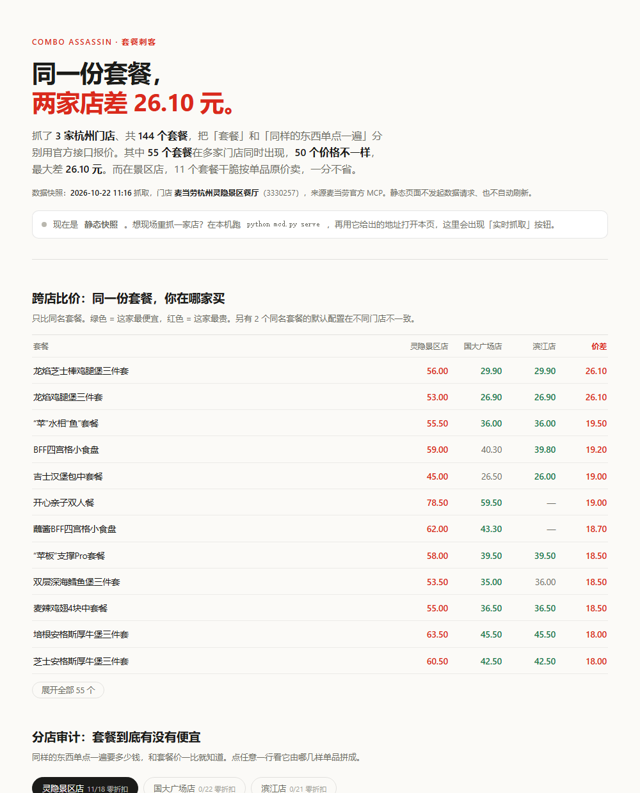

# 套餐刺客 · Combo Assassin

> 把套餐拆开算一遍，看它到底刺没刺你——以及你在哪家店被刺。
> 所有价格都来自麦当劳官方计价接口，不是菜单标价推算。

麦当劳程序员节创意开发大赛参赛作品 · 非麦当劳官方产品。

[](https://combo-assassin.app.workbuddy.host/?sharecode=S2XRGV6W7V)
  

---

## 🎮 在线试玩

**<https://combo-assassin.app.workbuddy.host/?sharecode=S2XRGV6W7V>**

点开就能玩：不需要登录、不需要 Token、不需要装任何东西，手机也能用。页面里有两层：

- **跨店比价**：同一份套餐，三家门店并排报价，绿 = 最便宜，红 = 最贵；
- **分店审计**：切任意一家店，看它的每个套餐「套餐价 vs 单点合计」，点行展开组成明细。

🖼️ 不想开网页：直接看 [`docs/preview-cross.png`](docs/preview-cross.png)
💻 想完全离线：下载仓库后双击 [`docs/index.html`](docs/index.html)，同一份页面，数据全部内嵌
⚡ 想要实时：本机跑 `python mcd.py serve`，再用它给出的地址打开——页面会出现「到店找店」面板，输商圈关键词列门店、标注营业状态，约 10 秒现场重抓整份菜单



---

## 结论

**① 同一份套餐，不同门店价格不一样，最大差 26.10 元。**

抓了杭州 3 家门店共 144 个套餐。55 个同名套餐在多家店同时出现，其中 **50 个价格不一样**：

```
龙焰芝士棒鸡腿堡三件套   灵隐景区店 56.00 ｜ 国大广场店 29.90 ｜ 滨江店 29.90   差 26.10
龙焰鸡腿堡三件套         灵隐景区店 53.00 ｜ 国大广场店 26.90 ｜ 滨江店 26.90   差 26.10
吉士汉堡包中套餐         灵隐景区店 45.00 ｜ 国大广场店 26.50 ｜ 滨江店 26.00   差 19.00
```

同一编码、同一配置，价格差出近一倍。**想吃同一份套餐，去错店要多花十几块。**

**② 「套餐是不是折扣」是分店的：景区店一分不省，市区店全在打折。**

| 门店 | 可比套餐 | 零折扣 | 真折扣 | 单点合计让价 |
|---|---:|---:|---:|---:|
| 灵隐景区店（天竺路） | 18 | **11（61%）** | 7（最多省 4 元） | 12.50 元 |
| 国大广场店（武林商圈） | 22 | 0 | **22（中位省 13.00 元）** | 308.40 元 |
| 滨江店（江一云境） | 21 | 0 | **21（中位省 13.00 元）** | 291.70 元 |

同一家连锁：市区店的套餐普遍比单点便宜 13 块；景区店的套餐 61% 按「单品原价相加」卖，一分不省。
我们最初只审计了灵隐店，得出「套餐不是折扣」——三店对比后修正：**那是景区店的定价特征，不是连锁的**。
（这个修正本身，就是为什么值得做跨店对比。）

**③ 在景区店，配菜位是固定锚点：25.50 元。**

「配菜位」= 套餐价 − 汉堡单点价。灵隐店 11 个三件套的配菜位全部精确等于 **25.50 元**（中薯条 14.50 + 可乐 11.00），汉堡从 19.50 换到 39.00 它纹丝不动。**在景区店，套餐不是给你折扣，是把配菜按原价绑上去。**

---

## 三个可以自己跑出来的结论

> 不想敲命令？[**在线试玩版**](https://combo-assassin.app.workbuddy.host/?sharecode=S2XRGV6W7V) 已经把这三条结论做成可点的图表。

```bash
git clone https://github.com/HadesWing/McDonald.git && cd McDonald

python mcd.py compare \
  --data data/store_hangzhou.json:灵隐景区店 \
  --data data/store_wulin.json:国大广场店 \
  --data data/store_binjiang.json:滨江店   # 跨店比价，无需 token

python mcd.py audit      # 单店审计：套餐价 vs 单品原价合计
python mcd.py slot       # 配菜位拆解
```

```
共 55 个同名套餐在 ≥2 家门店出现，其中 50 个价格不同（5 个一致），最大价差 26.10 元
```

想现场复核是不是官方数据：

```bash
python mcd.py audit --verify 5   # 重新调 calculate-price，并排打印官方值与本地值
```

---

## 实时模式与到店锁店

线上页面是构建期快照（打开即看，零请求）；想知道**此刻**的价格，跑本地服务：

```bash
set MCD_MCP_TOKEN=你的token      # https://open.mcd.cn/mcp 申请
python mcd.py serve              # → http://127.0.0.1:8765
```

浏览器直连不了 MCP（端点不开放 CORS，token 也不该进网页），所以实时能力做在本地服务里：页面探测到 `/api/health` 就亮出「**到店找店**」面板——输入商圈或路名，列出候选门店**并标注现在开着没有、还有多久关门**，点一家就现场抓完整份菜单出审计（**约 10 秒**，token 不出服务端，结果缓存 3 分钟）。

### 关于定位：MCP 没有定位能力，我们不装

实测结论，写在这里免得被问：

- `query-nearby-stores` **没有经纬度入参**（只有 `city + keyword`，`searchType` 只是枚举）；
- 返回体里门店的 `longitude` / `latitude` **恒为 0.0**，坐标不下发；
- 返回的 `distance` 不是到你的距离，是**到关键词解析出的地点**的距离——同一家店搜「灵隐」431 米、搜「西湖」2545 米。

所以「自动算出最近门店」在 MCP 层面做不到，硬做就是编数据。我们做的是诚实可用的替代：

1. **城市自动预填**：按出口 IP 猜（免费无 key，只到城市级，`GET /api/geo`）；
2. **门店靠关键词**：MCP 只认「城市+关键词」，到店看一眼招牌输 2 个字就够；
3. **到店记忆**：第一次选店后，浏览器把「当时拿到的 GPS 坐标 ↔ 这家店」记进 `localStorage`（不上传）；下次走到同一家店附近 400 米内，点「定位我附近的店」直接认出这家店，不用再搜。常去的店从此零输入。

命令行等价物：

```bash
python mcd.py locate --keyword 灵隐        # 列候选门店 + 营业状态 + 还有多久关门
python mcd.py fetch --city 杭州 --keyword 灵隐 --store-code 3330372   # 按编码精确抓取
```

---

## 为什么这个结论可信

因为每一分钱都来自官方接口：

1. `query-nearby-stores` 按城市/关键词定位门店；
2. `query-meals` + `query-meal-detail` 拿每个套餐的组成结构与可换选项；
3. `calculate-price` 对**套餐编码**报一次价；
4. `calculate-price` 对**套餐内各单品编码一起**再报一次价；
5. 两个数都是官方返回的实付金额，相减就是真实差价。

套餐里的饮料常是套餐专属编码（店里不能单点），项目会逐个补价；补不齐的直接判「不可比」，**不拿估算填坑**。跨店比价只比同名套餐，且两边都必须有官方报价。

---

## 这是什么，不是什么

| | |
|---|---|
| **是** | 一个把套餐定价拆开、跨门店比价的审计工具 |
| **不是** | 又一个「今天吃什么」的推荐助手 |
| **不做** | 猜你的口味、给套餐打分、编造「省了 XX 元」 |
| **只做** | 把官方报价摆在一起，告诉你差价是多少、差在哪 |

如果结论是「这个套餐没便宜」，它会直接说没便宜——哪怕这个结论推翻它自己上一版。

---

## 还能做什么

审计之外，仓库里还有一个**凑单求解器**（`mcd.py solve`），对真实菜单做 0-1 背包精确求解，回答「还差 5.5 元免配送费，加什么最不亏」。它和审计共享同一份数据，但结论经常反直觉——**有时候不凑单反而更省**。

```bash
python mcd.py solve --cart 巨无霸
```

---

## 项目结构

```
mcd.py                    CLI 入口（compare / audit / slot / solve / locate / fetch / serve / tools / call）
src/mcd_solver/
  mcp_client.py           零依赖 MCP 客户端（Streamable HTTP + SSE，含 429 退避）
  fetch.py                从官方 MCP 抓门店快照；SKU 级并发，单店约 10 秒
  compare.py              跨店比价：同名套餐并排报价、价差、配置差异
  decompiler.py           套餐结构解析、全配置枚举、换项净收益
  audit.py                套餐差价审计 + 配菜位定价分析
  optimizer.py            凑单 0-1 背包精确求解
  serve.py                本地实时服务（静态页 + /api/audit 现场抓取，token 不出服务端）
  geo.py                  到店定位补丁：IP 猜城市 / 门店营业状态 / 到店记忆距离比对
  catalog.py models.py    数据模型与快照加载
data/store_*.json         三家真实门店快照，离线可跑全部审计命令
tools/build_demo.py       把审计结果编译成单文件 HTML
docs/index.html           在线试玩页，同一份文件支持静态快照与本地实时两种模式
tests/                    单元测试
```

---

## 局限

- 只抓了**杭州 3 家门店、一个时间点**。「景区店贵、市区店打折」是一个样本量为 3 的观察，不是全网结论——这正是下一步要扩展的（欢迎拿自己的城市跑 `mcd.py fetch`）。
- 144 个套餐里只有 61 个可比。其余因为套餐内商品在该门店无法单点，项目会明确标注「不可比」并列出缺哪一项，不做估算。
- 跨店比价只对同名套餐，同名但默认配置不同的（2 个）已单独标注。
- 价格随时会变。快照时间见各 `data/store_*.json` 的 `meta.fetched_at`。

---

## 参赛

本项目参加**麦当劳程序员节创意开发大赛**，基于麦当劳官方 MCP Server 开发，非麦当劳官方产品。详细声明见 [CONTEST_DECLARATION.md](CONTEST_DECLARATION.md)，MCP 对接说明见 [docs/MCP_INTEGRATION.md](docs/MCP_INTEGRATION.md)。

餐品信息、价格与供应状态以麦当劳官方渠道实时结果为准。

🎮 试玩：<https://combo-assassin.app.workbuddy.host/?sharecode=S2XRGV6W7V>

如果这个结论对你有用，star 一下，让更多人看一眼自己的账单。
